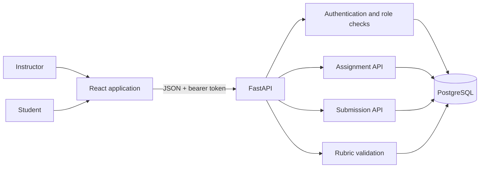

# GradeFlow architecture

GradeFlow is a prototype with a React client, FastAPI service, and SQLAlchemy persistence layer.

## System context

## Request flows

### Instructor publishes an assignment

1. The instructor signs in and receives a time-limited signed bearer token.
2. The React client sends an authenticated assignment request.
3. The API validates the instructor role and the assignment schema.
4. Rubric criteria must have unique names, and their maximum points cannot exceed the assignment total.
5. The service persists the assignment, its rubric criteria, and the authenticated instructor as its owner.

### Student submits work

1. A student registers with an administrator-issued signup code or signs in.
2. The API returns a time-limited signed bearer token.
3. The student lists active assignments and submits text.
4. The API verifies the student role and that the assignment is accepting submissions.
5. A student can read their own submissions; instructor-only routes expose submissions for an assignment.

## Persistence model

- `users`: email, password hash, role, creation timestamp.
- `assignments`: instructor owner, title, description, due date, total points, status.
- `rubric_criteria`: assignment reference, criterion name, maximum points, order.
- `submissions`: assignment reference, student reference, text content, status, submission timestamp.

## Security and operational boundaries

- Passwords are stored as scrypt hashes.
- Bearer tokens are signed and expire after eight hours.
- Student signup requires a configured private code.
- Production requires a private random `GRADEFLOW_SECRET_KEY`.
- Authentication throttling, password reset, MFA, token revocation, audit logging, and tenant isolation remain future work.
- CI runs API tests and applies database migrations against PostgreSQL 16. The API tests use an isolated in-memory SQLite database.

This is a software prototype, not a production-ready academic records system.
